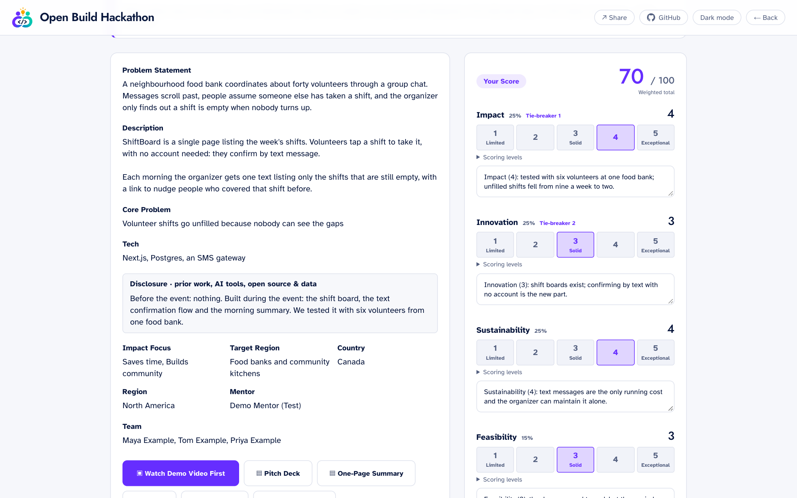
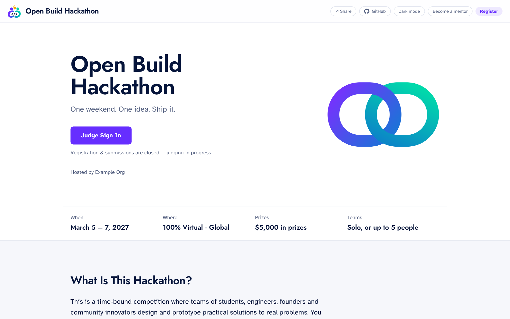
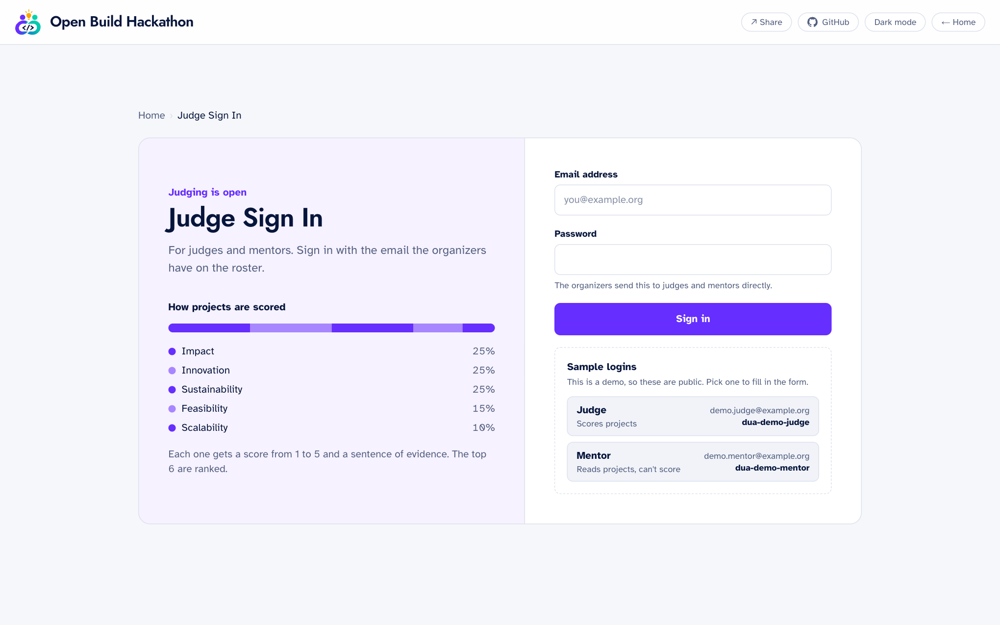
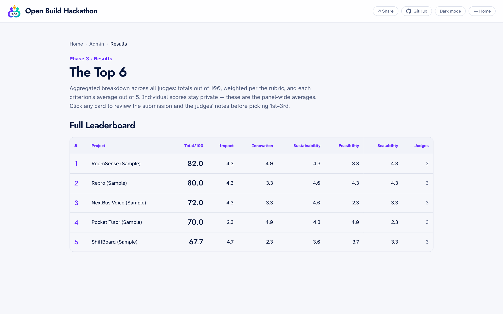
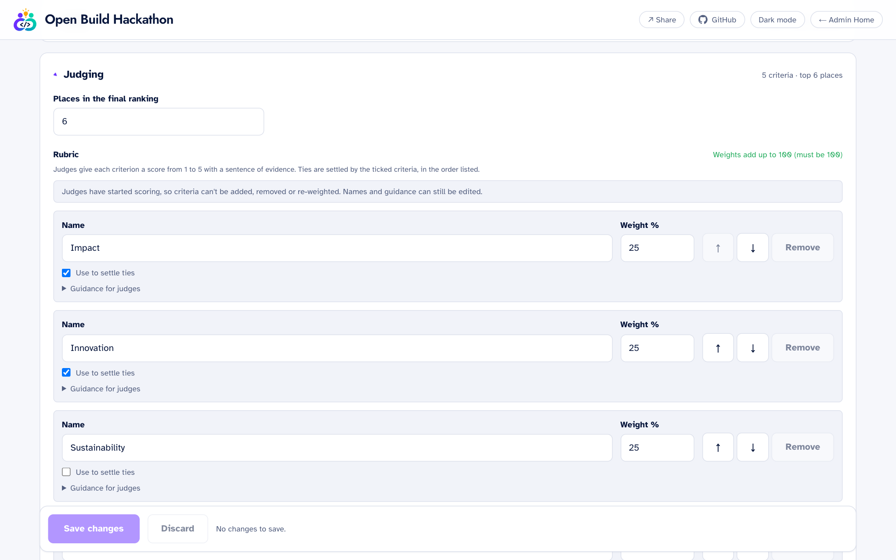

<p align="center">
  
</p>

<p align="center">
  <strong>The open source hackathon platform with judging you can defend.</strong>
</p>

<p align="center">
  <a href="https://dua-platform.vercel.app"></a>
  <a href="#contributors-wanted"></a>
</p>

<p align="center">
  <a href="https://dua-platform.vercel.app">Live demo</a> ·
  <a href="#quick-start">Quick start</a> ·
  <a href="#guides">Guides</a> ·
  <a href="#contributors-wanted">Contributors wanted</a>
</p>

# Dua

Dua is an open source platform for running a hackathon from first sign-up to
final results: registration, mentor sign-up, project submission, judging and a
leaderboard, in one app you host yourself.

What sets it apart is the judging. Every score comes with a sentence of
evidence, scores are evened out per judge so a harsh judge and a generous one
carry the same weight, judges can step back from projects they're connected
to, and the final ranking can be reproduced from a logged seed.

All it needs is Node.js and a Postgres database. Email, file storage and
judge sign-in work out of the box and can each be switched to a service you
already use, including Supabase.

## Live demo

**<https://dua-platform.vercel.app>**

A sample event, the Open Build Hackathon, with five projects waiting to be
judged. No sign-up needed: the logins are on the sign-in pages, and clicking
one fills in the form.

| Try this | Where | Sign in as |
| --- | --- | --- |
| Score a project against the rubric | [/judge](https://dua-platform.vercel.app/judge) | Judge |
| See what a mentor can and can't do | [/judge](https://dua-platform.vercel.app/judge) | Mentor |
| Look around the organizer's panel, including the event settings | [/admin](https://dua-platform.vercel.app/admin) | Admin (read-only) |
| See what participants see | [the homepage](https://dua-platform.vercel.app) | Nobody |

Go ahead and change things: the demo puts itself back every hour.

<a href="https://dua-platform.vercel.app"></a>

> **Status: early.** Dua runs today and ships with a made-up sample event, the
> Open Build Hackathon. Expect the database schema to change before 1.0; the
> [to-do list](#to-do) covers what isn't done yet.

## What you get

| Area | Route | Who | What it does |
| --- | --- | --- | --- |
| Home page | `/` | Public | Landing page whose main button follows the event phase: Register, then Judge Sign In, then View the Winners. |
| Registration | `/register` | Public | Participant sign-up. Opened and closed by an admin switch. |
| Mentor sign-up | `/mentor` | Public | Volunteer mentor sign-up, on the same switch as registration. |
| Submission | `/submit` | Public | Project submission form with a private edit link emailed to the team. Opened and closed by its own admin switch. |
| Judging | `/judge` | Judges, mentors | Sign in, then score each project 1–5 on the rubric you set, with one sentence of evidence per score. Judges can declare a conflict to recuse themselves. Mentors can read but not score. |
| Results | `/results` | Judges, mentors, admins; the public if you choose | Averages only, never one judge's scores, plus the final ranking. Visible once the phase is `results`. |
| Admin | `/admin` | Organizers | Phase control, registrations with CSV export, judges, submissions, results, email campaigns, and admin accounts with roles. |

The event moves through three phases, switched by an admin:
**submissions → judging → results**.

Organizers set up the whole event from the admin panel: its name and dates,
the questions on the forms, the rubric and judging rules, which features are
on, the colours and logo.

## Screenshots

<table>
  <tr>
    <td width="50%"><br><sub>The event's homepage</sub></td>
    <td width="50%"><br><sub>Judge sign-in, showing how projects are scored</sub></td>
  </tr>
  <tr>
    <td><br><sub>Results: panel averages, never one judge's scores</sub></td>
    <td><br><sub>Setting the rubric in the admin panel</sub></td>
  </tr>
</table>

## Quick start

You need [Node.js](https://nodejs.org) 22.9 or newer, and Docker Desktop or
OrbStack running.

```bash
git clone https://github.com/lenichols/dua-platform.git
cd dua-platform
npm install
cp .env.local.example .env.local
```

Open `.env.local` and fill in `ADMIN_PASSWORD` (make one up) and
`SUBMISSION_EDIT_SECRET` (`openssl rand -hex 32` prints one). Then:

```bash
npm run db:up        # start the database
npm run db:migrate   # create the tables
npm run db:seed      # add sample projects and sample logins
npm run dev          # start the site
```

Open <http://localhost:3000>. The sign-in pages at `/judge` and `/admin` list
sample logins you can click to use.

No Docker, or something not working? See
[Running Dua locally](docs/running-locally.md) and
[Database options](docs/database.md).

> **Before a real event, turn demo mode off.** Remove `DEMO_MODE=true` from
> `.env.local` and run `npm run db:seed -- --cleanup`. While it's on, the
> sign-in pages show working logins to anyone.

## Guides

| Guide | What's in it |
| --- | --- |
| [Running Dua locally](docs/running-locally.md) | The full walk-through, sample logins, stopping and restarting, troubleshooting. |
| [Database options](docs/database.md) | Docker Desktop, OrbStack, Supabase, your own Postgres, and browsing data with pgAdmin. |
| [Setting up your event](docs/your-event.md) | What organizers can change in the admin panel. |
| [How judging works](docs/judging.md) | The ranking method, and who can see what. |
| [Providers](docs/providers.md) | Email over Resend or SMTP, files in S3 or Supabase, judge sign-in through Supabase. |
| [Deploying and settings](docs/deploying.md) | Putting Dua on a server, every environment variable, and the command-line helpers. |

## Contributors wanted

Dua is new and maintained by a very small team, and it's looking for people
to help build it. If you've run a hackathon, judged one, or just like working
on software people use at real events, you'd be welcome.

**Where help is most useful**

- **Front end:** the admin panel needs a screen-by-screen tidy, and every page
  needs checking on a phone.
- **Testing:** an end-to-end suite that drives a real browser through signing
  in, scoring and the event settings.
- **Deployment:** a container image for the app, and trying the email and
  storage providers against the real services.
- **Organizers and judges:** you don't need to write code. Run the
  [demo](https://dua-platform.vercel.app), tell us what your event would need
  that isn't there, and what the rubric or the forms get wrong.

Everything that needs doing is listed just below, under [To do](#to-do).

**How to start**

1. Get it running: the [quick start](#quick-start) takes about five minutes.
2. Pick something from the [to-do list](#to-do) below, or bring your own idea, and
   [open an issue](https://github.com/lenichols/dua-platform/issues/new/choose) or comment on the [contributors thread](https://github.com/lenichols/dua-platform/issues/1)
   so we can agree on the approach before you spend time on it.
3. Read [CONTRIBUTING.md](.github/CONTRIBUTING.md), then send a pull request.
   Small ones are welcome.

On your first pull request you'll be asked to sign the
[contributor license agreement](.github/CLA.md). Please report security
problems privately, as described in [SECURITY.md](.github/SECURITY.md).

## To do

This is the work contributors can pick up. Dua runs as it is, so none of it
is urgent, and every item is open: nobody is assigned unless an issue says
so. To claim one, comment on the
[contributors thread](https://github.com/lenichols/dua-platform/issues/1) or
open an issue for it, as described [above](#contributors-wanted).

**Setup and testing**

- [ ] A container image for the app, so `docker compose up` starts everything
      and not only the database.
- [ ] An end-to-end test suite that drives a real browser through signing in,
      scoring, the Event tab and the public forms, and runs in CI.
- [ ] Check the optional providers against the real services: Resend, S3 on
      AWS itself, and a hosted Supabase project. So far they've been run
      against local stand-ins (see `npm run test:live`).

**Admin panel**

- [ ] Create and switch between events. The database already keeps every
      event's data separate; one deployment still serves one event.
- [ ] A screen-by-screen tidy of the admin panel. It follows the current
      look, but its layouts predate it.
- [ ] Set fonts and the page background colours from the Event tab. Today
      only the accent colour and logo can be changed there.

**Forms**

- [ ] A check of every page at phone width.
- [ ] Let organizers reorder questions, and place their own among the
      built-in ones rather than in a section at the end.

**Housekeeping**

- [ ] Rename `top6` in the code and database. The number of ranked places is
      a setting now; the name is left over from when it was fixed at six.
- [ ] Rework the two effects that set state on mount (theme toggle, admin
      paging), which lint currently reports as warnings.

## License

[GNU Affero General Public License v3.0](LICENSE). You can use, change and
host Dua freely. If you run a changed version as a service for other people,
you must make your changes available to them under the same license.
