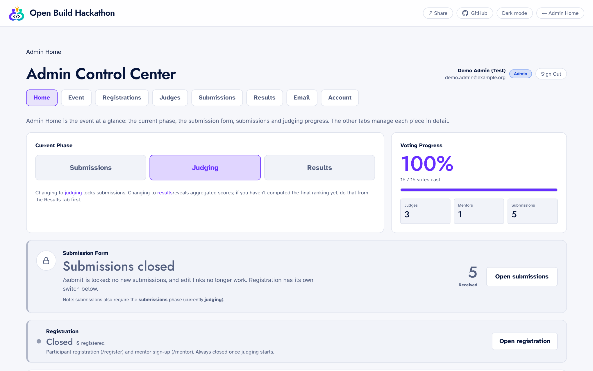

# Setting up your event

Everything about your event is set in the admin panel. Nothing here needs code.

## First steps

1. Go to `/admin`, leave the email blank and sign in with `ADMIN_PASSWORD`.
2. **Team** tab: create your own owner account, and one for each organizer.
   Then sign in as yourself and keep `ADMIN_PASSWORD` for emergencies.
3. **Judges** tab: add judges and mentors, then set the shared sign-in
   password and send it to them yourself.
4. **Event** tab: put in your event's name, dates, tracks and rubric.
5. **Home** tab: open registration and submissions when you're ready, switch
   to **judging** to start scoring, then **results**.

Before real submissions open, remove the samples with
`npm run db:seed -- --cleanup`.

## What you can change

Sign in to `/admin` and open the **Event** tab. Everything about your event is
edited there and takes effect when you press Save:

| Section | What you can change |
| --- | --- |
| Basics | Name, tagline, dates, deadlines, format, prizes, host, contact email, largest team size. |
| Look | The accent colour used across the site (violet by default, lightened automatically in dark mode), and your own logo in place of the Dua mark. |
| Features | Whole parts of the platform you may not need: the mentor programme, registration before submitting, email campaigns, and the "How it works" steps on the homepage. |
| Judging | The rubric: criteria, their weights, the guidance judges see, and which criteria settle ties. How many places the final ranking has. The judging rules below. |
| Questions | Switch off built-in questions your event doesn't need, and add your own, on the registration, mentor and submission forms: short or long text, pick one, pick any, or a link. Choose which answers judges see. |
| Form options | The choices on the registration, mentor and submission forms: tracks, problem briefs, experience levels and so on. |
| Homepage | The introduction, highlight cards, an example problem per track, and the questions and answers. |

Once the first judge has scored a project, the rubric's criteria and weights
are fixed, because changing them would change what existing scores mean.
Names and guidance can still be edited.

## Judging rules

Each of these is a switch under **Event → Judging**. The defaults are in bold.

| Rule | What it does |
| --- | --- |
| Anonymous judging (**off**) | Judges and mentors don't see team names, member names or the mentor's name. Admins still do. |
| Require evidence (**on**) | Each score needs a sentence saying what the team showed. Off makes it optional. |
| Conflict declarations (**on**) | Judges can step back from a project they're connected to, which also removes any score they gave it. |
| Publish the final ranking (**off**) | Once results are open, anyone can see the placed projects and their totals. Nothing else is published: not the other entries, not judges' notes. |
| How the ranking is worked out (**even out judges**) | Either even out harsh and generous judges and test how stable the ranking is, or rank by the plain average of judges' totals. See [How judging works](judging.md). |

## Questions you can switch off

Names, emails and the project's name, description and summary are always
asked. Everything else on the three forms can be switched off under
**Event → Questions**, including phone numbers, the LinkedIn-or-website
identity check on registration, location, team-mates' details, the track,
category and technologies, the code links, the demo and pitch videos, the
pitch deck and disclosure, and the LinkedIn announcement.

The instructions judges read before scoring follow these switches, so they
never point at something your form doesn't collect.

A new event starts with the sample content in
[`src/lib/event-settings.ts`](../src/lib/event-settings.ts).

The site opens in a light theme; visitors can switch to dark from the header.
Fonts (Jost for headings, Atkinson Hyperlegible for everything else) and the
page background colours are set in code: [`src/app/layout.tsx`](../src/app/layout.tsx)
and [`src/app/globals.css`](../src/app/globals.css).

## Admin roles

| Role | Can do |
| --- | --- |
| Owner | Everything, including creating and removing admin accounts. |
| Admin | Run the event: phases, judges, submissions, results. Can't manage admin accounts. |
| Viewer | Read-only. Can watch progress and export CSVs. The server refuses writes even if a request is forged. |

Roles are read from the database on every request, so removing someone takes
effect immediately. Passwords are stored as scrypt hashes, and repeated failed
sign-ins are locked out for 15 minutes.

---

[Back to the README](../README.md)
